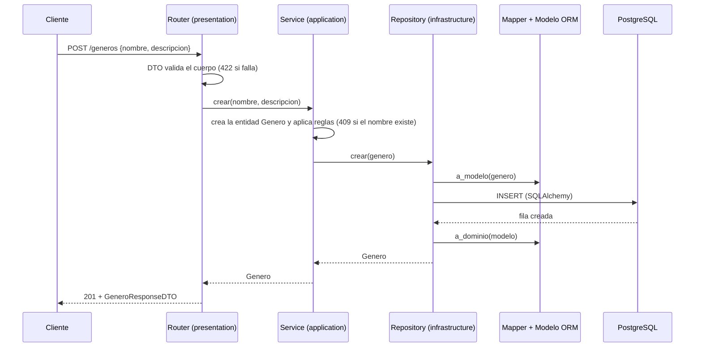
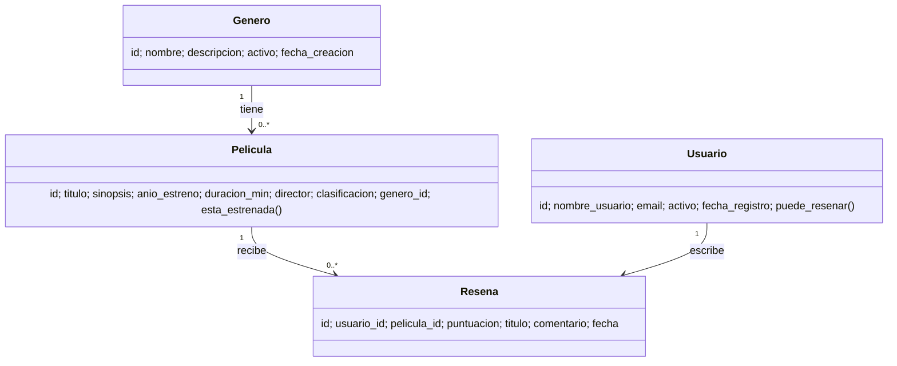
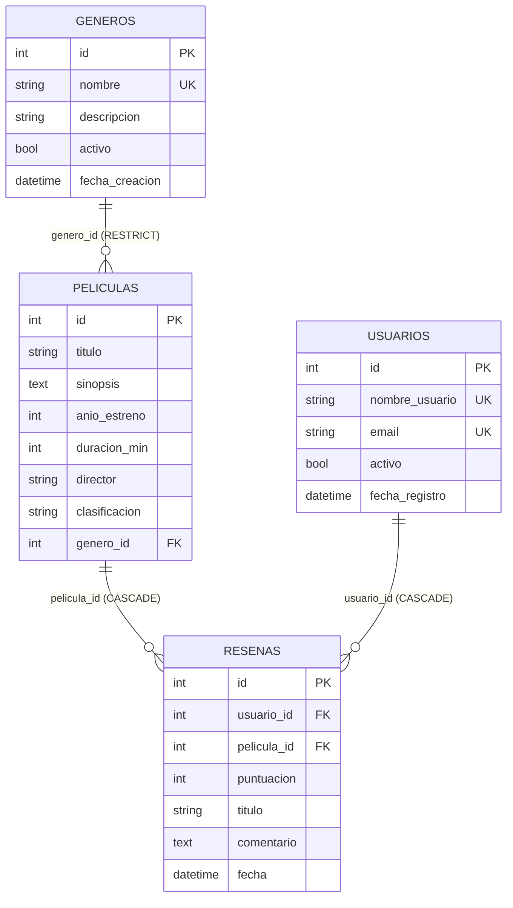

# API de Reseñas de Películas — backend-2026-grupo-04

Proyecto grupal de **Desarrollo de Backend (ICINF1108)**. API REST, estilo IMDb, donde las personas aficionadas al cine consultan un catálogo de películas organizado por género y publican reseñas con puntuación de 1 a 10.

> **Estado:** base del proyecto + recorrido completo de **Géneros**. Las secciones marcadas con ⏳ se completan a medida que el equipo integra sus ramas (ver tabla de endpoints y `docs/backlog.md`).

## Problemática

Quienes ven películas dejan sus opiniones repartidas en redes sociales y chats, sin una organización común por película y género. Esta API centraliza el catálogo y las reseñas: permite registrar películas y usuarios, publicar una única reseña por película y consultar el catálogo con filtros, orden y paginación.

---

## Alcance real de esta versión inicial (v0.1.0)

- Implementado: CRUD de Géneros (5 operaciones HTTP), DTO, reglas de Géneros, errores uniformes, sesiones por solicitud y seeder de Géneros.
- Preparado: cuatro entidades de dominio, cuatro modelos ORM, relaciones, migración inicial, Docker Compose y DTO común de paginación.
- Pendiente: recorridos de Usuarios, Películas y Reseñas; consulta combinada; seeders restantes; evidencias completas y defensa.
- Los archivos con `TODO` son tareas futuras, no endpoints funcionales. La tabla REST distingue el contrato previsto del disponible.
- Esta base no satisface todavía los 12 endpoints ni los dos registros por cada entidad exigidos para la entrega.
- El estreno se representa por año, no por fecha exacta. No hay autenticación, permisos, ranking ni frontend.

## Usar con tu PostgreSQL existente en Docker

Conserva tu `.env`. El proyecto espera `DB_HOST`, `DB_PORT`, `DB_NAME`, `DB_USER` y `DB_PASSWORD` (ver ejemplo sin credenciales reales).
Si ejecutas la API en Windows y PostgreSQL en Docker, usa el host y puerto publicados del contenedor. No es necesario levantar otro contenedor con este Compose.
Ejecuta `uv sync`, `uv run alembic upgrade head`, `uv run python -m app.seed` y después `uv run uvicorn app.main:app --reload`.
Aplica la migración sobre una base destinada a este proyecto; si ya tiene tablas, revisa su estado antes de migrar. No borres volúmenes ni marques una migración como aplicada sin comprobar el esquema.

## Tecnologías

| Tecnología | Uso |
|---|---|
| Python 3.12+ | Lenguaje |
| FastAPI + Uvicorn | API HTTP y servidor |
| Pydantic | DTO y validación de entrada/salida |
| SQLAlchemy 2 | ORM (modelos, sesiones, consultas) |
| PostgreSQL 16 | Base de datos |
| Alembic | Migraciones versionadas |
| uv | Entorno virtual y dependencias |
| Docker Compose | PostgreSQL reproducible (opcional) |

---

## Ejecución desde una copia limpia

Requisitos: Python 3.12+, [uv](https://docs.astral.sh/uv/), Git y Docker (o un PostgreSQL local).

```bash
# 1. Clonar e instalar dependencias
git clone <URL_REAL_DEL_REPOSITORIO> backend-2026-grupo-04
cd backend-2026-grupo-04
uv sync

# 2. Solo si aún NO tienes un .env configurado
cp .env.example .env          # en PowerShell: Copy-Item .env.example .env
# Si ya tienes un .env conectado a Docker, CONSÉRVALO y omite esta copia.
#    edita .env y cambia DB_PASSWORD

# 3. Base de datos PostgreSQL (con Docker)
docker compose up -d

# 4. Migraciones (crea las tablas desde cero)
uv run alembic upgrade head

# 5. Iniciar la API (al arrancar, los seeders cargan datos de ejemplo si la base está vacía)
uv run uvicorn app.main:app --reload
```

- Swagger (OpenAPI interactivo): <http://127.0.0.1:8000/docs>
- ReDoc: <http://127.0.0.1:8000/redoc>
- Especificación JSON: <http://127.0.0.1:8000/openapi.json>

**Si el puerto 5432 está ocupado** (otro PostgreSQL o contenedor): cambia `DB_PORT=5433` en tu `.env` y vuelve a ejecutar `docker compose up -d`; el `docker-compose.yml` usa ese mismo valor.

**Sin Docker:** instala PostgreSQL, crea el usuario y la base con los mismos valores del `.env` y salta el paso 3.

### Variables de entorno (`.env.example`)

| Variable | Ejemplo | Descripción |
|---|---|---|
| `DB_HOST` | `localhost` | Servidor de la base |
| `DB_PORT` | `5432` | Puerto publicado de PostgreSQL |
| `DB_NAME` | `cine_resenas` | Nombre de la base |
| `DB_USER` | `cine` | Usuario |
| `DB_PASSWORD` | `cambiar_esta_clave` | Contraseña (poner una propia en tu `.env`) |

### Migraciones y seeders

- **Migraciones:** `migrations/versions/0001_crear_tablas.py` crea `generos`, `usuarios`, `peliculas` y `resenas` desde cero. Se aplican con `uv run alembic upgrade head` y se revierten con `uv run alembic downgrade base`.
- **Seeders:** cargan datos de ejemplo coherentes (con relaciones 1:N). Se ejecutan al iniciar la API y a mano con `uv run python -m app.seed`. Cada entidad se siembra solo si su tabla está vacía, por lo que no agregan duplicados en una tabla ya poblada. No reparan cargas parciales.
- **Reiniciar todo desde cero:** `docker compose down -v && docker compose up -d`, luego migraciones y API.
- **Persistencia:** los datos viven en el volumen `pgdata_resenas`; sobreviven al reinicio de la API y del contenedor.

---

## Arquitectura por capas

```text
app/main.py                  # crea y ensambla la API (routers, errores, lifespan)
app/seed.py                  # carga inicial de datos
presentation/                # CAPA DE PRESENTACIÓN: recibe HTTP
    dependencies.py          #   sesión por solicitud e inyección de servicios
    error_handlers.py        #   errores -> JSON uniforme
    routers/                 #   endpoints
    schemas/dtos/            #   DTO de entrada/salida y validación
application/services/        # CAPA DE APLICACIÓN: casos de uso y reglas de negocio
domain/                      # CAPA DE DOMINIO: entidades y errores (sin FastAPI ni BD)
infrastructure/              # CAPA DE INFRAESTRUCTURA
    database.py              #   conexión y sesiones
    models/                  #   modelos ORM (tablas)
    mappers/                 #   conversión modelo ORM <-> entidad de dominio
    repositories/            #   único lugar con consultas a la BD
    seeders/                 #   datos iniciales
migrations/                  # migraciones Alembic (env.py, versions/)
tests_manual/                # pruebas .http y evidencias
docs/                        # backlog y documentación
```

| Capa | Responsabilidad | Qué NO hace |
|---|---|---|
| **presentation** | Recibe HTTP, valida con DTO, llama al servicio y devuelve la respuesta | No contiene lógica de negocio ni consultas a la BD |
| **application** | Coordina casos de uso y aplica reglas de negocio | No conoce HTTP ni SQL |
| **domain** | Entidades, invariantes y errores del dominio | No depende del framework ni de la BD |
| **infrastructure** | Conexión, modelos ORM, mappers, repositorios, seeders | No decide reglas de negocio |

### Recorrido de una solicitud



Los errores viajan como excepciones de dominio (`RecursoNoEncontradoError`, `ConflictoError`, `ReglaNegocioError`) y `presentation/error_handlers.py` las convierte en el JSON uniforme.

---

## Modelo del dominio

### Diagrama de clases



### Diagrama de datos (tablas)



Restricción adicional: `UNIQUE (usuario_id, pelicula_id)` en `resenas` (una reseña por usuario y película).

### Reglas de negocio

| # | Regla | Respuesta | Estado |
|---|---|---|---|
| RN1 | Un usuario solo puede reseñar una película una vez | 409 | ⏳ |
| RN2 | No se puede reseñar una película cuyo año de estreno sea posterior al año actual | 400 | ⏳ |
| RN3 | Un usuario inactivo no puede publicar reseñas | 400 | ⏳ |
| RN4 | No se puede eliminar un género que tiene películas | 409 | ✅ |

### Validaciones de datos

| Tipo | Ejemplo | Estado |
|---|---|---|
| Longitud | nombre de género 2–50 caracteres; comentario mínimo 10 | ✅ / ⏳ |
| Numérica | puntuación 1–10; duración > 0; `limite` 1–100 | ⏳ |
| Valores permitidos | clasificación `TP`, `+14`, `+18`; `direccion` asc/desc | ⏳ |
| Formato | email válido | ⏳ |
| Existencia relacionada | `usuario_id`, `pelicula_id`, `genero_id` deben existir | ⏳ |
| Regla de negocio | RN1–RN4 | ver arriba |

---

## Contrato REST

Documentado en Swagger (`/docs`). Todas las colecciones usan sustantivos en plural.

| Método | URI | Descripción | Éxito | Errores | Estado |
|---|---|---|---|---|---|
| POST | `/generos` | Crear género | 201 | 409, 422 | ✅ |
| GET | `/generos` | Listar géneros | 200 | 422 | ✅ |
| GET | `/generos/{genero_id}` | Obtener género | 200 | 404, 422 | ✅ |
| PUT | `/generos/{genero_id}` | Actualizar género | 200 | 404, 409, 422 | ✅ |
| DELETE | `/generos/{genero_id}` | Eliminar género | 204 | 404, 409, 422 | ✅ |
| POST | `/usuarios` | Crear usuario | 201 | 409, 422 | ⏳ |
| GET | `/usuarios` | Listar usuarios (paginado) | 200 | 422 | ⏳ |
| GET | `/usuarios/{usuario_id}` | Obtener usuario | 200 | 404 | ⏳ |
| PUT | `/usuarios/{usuario_id}` | Actualizar usuario | 200 | 404, 409, 422 | ⏳ |
| DELETE | `/usuarios/{usuario_id}` | Eliminar usuario | 204 | 404 | ⏳ |
| POST | `/peliculas` | Crear película | 201 | 404, 422 | ⏳ |
| GET | `/peliculas` | Listar con **filtro + orden + paginación** | 200 | 422 | ⏳ |
| GET | `/peliculas/{pelicula_id}` | Obtener película | 200 | 404 | ⏳ |
| PUT | `/peliculas/{pelicula_id}` | Actualizar película | 200 | 404, 422 | ⏳ |
| DELETE | `/peliculas/{pelicula_id}` | Eliminar película | 204 | 404 | ⏳ |
| POST | `/resenas` | Crear reseña | 201 | 400, 404, 409, 422 | ⏳ |
| GET | `/resenas` | Listar reseñas (paginado) | 200 | 422 | ⏳ |
| GET | `/resenas/{resena_id}` | Obtener reseña | 200 | 404 | ⏳ |
| PUT | `/resenas/{resena_id}` | Actualizar reseña | 200 | 404, 422 | ⏳ |
| DELETE | `/resenas/{resena_id}` | Eliminar reseña | 204 | 404 | ⏳ |
| GET | `/peliculas/{pelicula_id}/resenas` | Reseñas de una película | 200 | 404 | ⏳ |

### Filtro, orden y paginación (`GET /peliculas`)

```text
GET /peliculas?genero_id=2&anio=2010&ordenar_por=titulo&direccion=asc&pagina=1&limite=10
```

Se aplica en este orden: **filtrar → ordenar → paginar**. Respuesta:

```json
{ "items": [], "total": 85, "pagina": 1, "limite": 10, "total_paginas": 9 }
```

### Formato uniforme de errores

```json
{ "error": { "code": "RESOURCE_NOT_FOUND", "message": "No existe un género con el ID solicitado.", "details": [] } }
```

| Código HTTP | `code` | Cuándo |
|---|---|---|
| 400 | `BUSINESS_RULE_VIOLATION` | Viola una regla de negocio |
| 404 | `RESOURCE_NOT_FOUND` | El recurso no existe |
| 409 | `RESOURCE_CONFLICT` | Duplicado o conflicto con el estado actual |
| 422 | `VALIDATION_ERROR` | Datos que no cumplen el esquema (`details` lista cada campo) |

---

## Pruebas

Casos reproducibles en `tests_manual/pruebas.http` (extensión *REST Client* de VS Code o Thunder Client) y su registro de esperado/obtenido en `tests_manual/evidencias.md`. Para restablecer los datos de prueba: `docker compose down -v`, `docker compose up -d`, migraciones y API.

---

## Integrantes y responsabilidades

| Integrante | Área de responsabilidad | Foco técnico |
|---|---|---|
| Vicente Fonseca (jefe de grupo) | Coordinación y seguimiento + Documentación e integración | Backlog, README, OpenAPI, diagramas, integración de PR |
| Matías Manquelaf | Dominio y datos | Usuarios, modelo persistente, migración, seeders |
| Miguel Torres | API y lógica de negocio | Películas, filtro/orden/paginación |
| Danna Ramirez | Calidad y pruebas | Reseñas y reglas de negocio, pruebas y evidencias |

Las áreas indican seguimiento principal, no tareas exclusivas: todos participan en implementación, pruebas e integración.

## Flujo de trabajo con Git

- Flujo acordado: cambios por *pull request* con revisión de otra persona. El jefe debe activar y verificar la protección de `main` en GitHub.
- Una rama por tarea: `feature/<tarea>` (por ejemplo `feature/usuarios-repositorio`).
- Commits pequeños que indican la acción (por ejemplo «Agrega regla de reseña única por usuario»).
- El `.env` nunca se sube; solo `.env.example`.


## Verificación de la versión inicial

```powershell
uv run python -m unittest discover -s tests -v
uv run alembic current
uv run alembic check
```

Los tests automatizados invocan las funciones de rutas y servicios con una base SQLite temporal aislada: verifican CRUD, validaciones, excepciones de dominio, contrato y conservación al reabrir conexiones. No son pruebas HTTP de extremo a extremo ni verifican los manejadores HTTP. No sustituyen la prueba de migraciones y reinicio con PostgreSQL. Las evidencias de PostgreSQL se completan en `tests_manual/evidencias.md` después de ejecutar las solicitudes.

## Primer envío al repositorio

Conserva el `.git` de tu repositorio existente y tu `.env` local al copiar esta base. El paquete no contiene historial Git ni credenciales.
Antes de agregar archivos revisa `git status --short` y confirma que `.env` y `.venv` están excluidos. Si `.env` ya estaba versionado, `.gitignore` no lo retira del historial.
El primer commit debe describir el trabajo real, por ejemplo: `Agrega base por capas y CRUD persistente de géneros`.
Cada integrante debe realizar sus propias contribuciones: mínimo cinco commits significativos, una rama distinta de main y un PR. Esta base no acredita contribuciones de los cuatro.
