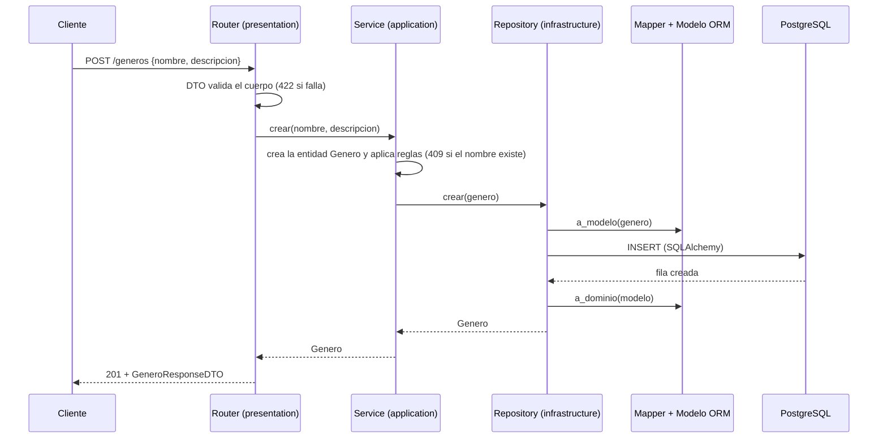
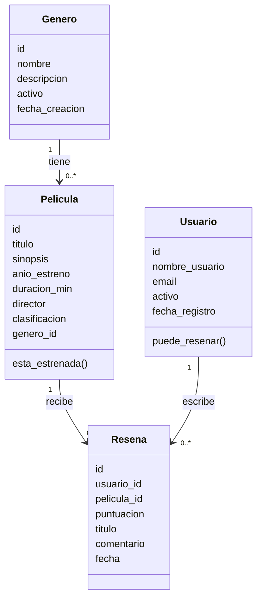
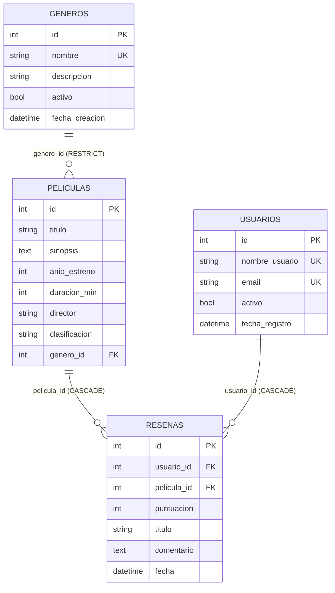

# API de Reseñas de Películas — backend-2026-grupo-04

Proyecto grupal de **Desarrollo de Backend (ICINF1108)**. API REST, estilo IMDb, donde las personas aficionadas al cine consultan un catálogo de películas organizado por género y publican reseñas con puntuación de 1 a 10.

> **Estado de esta rama (`feature/peliculas`):** CRUD de Géneros, Usuarios y Películas, con filtro, orden y paginación del catálogo y carga inicial explícita de Géneros y Películas. Los cambios de Películas están pendientes de revisión e integración mediante PR. Reseñas y las evidencias finales siguen pendientes. Este documento describe la rama de Miguel; no acredita que Películas ya esté integrado en `main`.

## Problemática

Quienes ven películas dejan sus opiniones repartidas en redes sociales y chats, sin una organización común por película y género. Esta API centraliza el catálogo y las reseñas: permite registrar películas y usuarios, publicar una única reseña por usuario y película y consultar el catálogo con filtros, orden y paginación.

---

## Alcance de la versión de trabajo (v0.1.0)

- Implementado: CRUD de Géneros, Usuarios y Películas; DTO, servicios, repositorios, mappers, sesiones por solicitud y errores uniformes.
- Películas permite combinar filtros, orden y paginación sobre PostgreSQL en un mismo GET.
- Persistencia: cuatro modelos ORM y migración inicial con sus relaciones y restricciones.
- Carga inicial explícita disponible: Géneros y Películas. Usuarios y Reseñas mantienen sus seeders pendientes según el estado conocido.
- Pendiente: funcionalidad de Reseñas, seeders restantes, comprobación conjunta de cascadas, pruebas finales, evidencias y defensa.
- El contrato de esta rama incluye 15 operaciones de Géneros, Usuarios y Películas; Reseñas agrega seis operaciones previstas todavía pendientes.
- Los archivos con TODO representan trabajo pendiente; las tablas existentes no equivalen a endpoints implementados.
- El estreno se representa por año, no por fecha exacta. No hay autenticación, permisos, ranking ni frontend.
- La implementación no equivale a evidencia de ejecución: los casos finales deben comprobarse y registrarse al cerrar el proyecto.

## Problemática y alcance: P1–P7

Las siguientes respuestas definen el escenario propuesto por el equipo; no representan resultados de una investigación de usuarios.

- **P1. Situación:** las opiniones sobre películas quedan dispersas en chats y redes sociales, sin una organización común por título y género.
- **P2. Actores:** personas aficionadas al cine que consultan y publican opiniones; personas encargadas de mantener el catálogo. Estos actores no implican permisos implementados.
- **P3. Consecuencias:** dificultad para encontrar opiniones de una película y trabajo manual para mantener títulos y géneros consistentes.
- **P4. Información:** géneros, usuarios, películas y reseñas, con los atributos y relaciones indicados en los diagramas.
- **P5. Acciones previstas:** el sistema debe permitir crear géneros; consultar y mantener géneros; registrar usuarios; consultar y mantener usuarios; registrar películas con un género existente; consultar y mantener películas; filtrar, ordenar y paginar el catálogo; publicar una reseña por usuario y película; consultar y editar reseñas; eliminar reseñas; consultar reseñas de una película; recuperar cambios tras reiniciar. Géneros, Usuarios y Películas están disponibles en esta rama; Reseñas sigue pendiente.
- **P6. Exclusiones:** frontend, autenticación/autorización, recomendaciones o ranking automático, integración con plataformas externas y moderación automática.
- **P7. Aceptación prevista:** instalación desde copia limpia; cuatro entidades con ID y cuatro atributos útiles; al menos doce endpoints funcionales; CRUD persistente; rechazo de datos y referencias inválidas; tres reglas de negocio comprobables; filtro, orden y paginación en un mismo GET; seeders con al menos dos registros por entidad; pruebas reproducibles con esperado y obtenido. Estos objetivos no están todos completados.

## Usar con tu PostgreSQL existente en Docker

Conserva tu `.env`. El proyecto espera `DB_HOST`, `DB_PORT`, `DB_NAME`, `DB_USER` y `DB_PASSWORD` (ver ejemplo sin credenciales reales).
Si ejecutas la API en Windows y PostgreSQL en Docker, usa el host y puerto publicados del contenedor. No es necesario levantar otro contenedor con este Compose.
Ejecuta `uv sync`, `uv run alembic upgrade head`, `uv run python -m app.seed` y después `uv run uvicorn app.main:app --reload`.
Aplica la migración sobre una base destinada a este proyecto; si ya tiene tablas, revisa su estado antes de migrar. No borres volúmenes ni marques una migración como aplicada sin comprobar el esquema.

## Tecnologías

| Tecnología | Uso |
|---|---|
| Python 3.12+ | Lenguaje |
| FastAPI + Uvicorn | API HTTP y servidor |
| Pydantic | DTO y validación de entrada/salida |
| SQLAlchemy 2 | ORM (modelos, sesiones, consultas) |
| PostgreSQL 16 | Base de datos |
| Alembic | Migraciones versionadas |
| uv | Entorno virtual y dependencias |
| Docker Compose | PostgreSQL reproducible (opcional) |

---

## Ejecución desde una copia limpia

Para reproducir los cambios de Miguel antes de su integración, se clona `feature/peliculas`. Después del merge se puede clonar `main`.

Requisitos: Python 3.12+, [uv](https://docs.astral.sh/uv/), Git y Docker (o un PostgreSQL local).

```powershell
# 1. Clonar e instalar dependencias
git clone --branch feature/peliculas https://github.com/vfonseca2026-afk/backend-2026-grupo-04.git
cd backend-2026-grupo-04
uv sync

# 2. Solo si aún NO tienes un .env configurado
Copy-Item .env.example .env  # Solo PowerShell
# Si ya tienes un .env conectado a Docker, CONSÉRVALO y omite esta copia.
#    edita .env y cambia DB_PASSWORD

# 3. Base de datos PostgreSQL (con Docker)
docker compose up -d
docker compose ps
# Esperar a que el servicio db esté healthy.

# 4. Migraciones (crea las tablas desde cero)
uv run alembic upgrade head

# 5. Cargar géneros y películas iniciales explícitamente
uv run python -m app.seed

# 6. Iniciar la API
uv run uvicorn app.main:app --reload
```

- Swagger (OpenAPI interactivo): <http://127.0.0.1:8000/docs>
- ReDoc: <http://127.0.0.1:8000/redoc>
- Especificación JSON: <http://127.0.0.1:8000/openapi.json>

**Si el puerto 5432 está ocupado** (otro PostgreSQL o contenedor): cambia `DB_PORT=5433` en tu `.env` y vuelve a ejecutar `docker compose up -d`; el `docker-compose.yml` usa ese mismo valor.

**Sin Docker:** instala PostgreSQL, crea el usuario y la base con los mismos valores del `.env` y salta el paso 3.

En Linux, sustituir la copia de PowerShell por:

```bash
test -f .env || cp .env.example .env
nano .env
```

Los comandos `uv`, `git` y `docker compose` de la secuencia son los mismos. Docker debe estar instalado y en ejecución.
La aplicación usa el puerto 8000; cambiar el puerto de PostgreSQL no cambia el de Swagger.

### Variables de entorno (`.env.example`)

| Variable | Ejemplo | Descripción |
|---|---|---|
| `DB_HOST` | `127.0.0.1` | Servidor de la base |
| `DB_PORT` | `5432` | Puerto publicado de PostgreSQL |
| `DB_NAME` | `cine_resenas` | Nombre de la base |
| `DB_USER` | `cine` | Usuario |
| `DB_PASSWORD` | `cambiar_esta_clave` | Contraseña (poner una propia en tu `.env`) |

### Migraciones y seeders

- **Migraciones:** `migrations/versions/0001_crear_tablas.py` crea `generos`, `usuarios`, `peliculas` y `resenas` desde cero. Se aplican con `uv run alembic upgrade head` y se revierten con `uv run alembic downgrade base`.
- **Seeders disponibles:** Géneros y Películas. Ejecutar `uv run python -m app.seed` después de aplicar migraciones. Primero se cargan Géneros y después Películas, únicamente si cada tabla está vacía. Una tabla poblada se omite; no se completan cargas parciales. Los seeders de Usuarios y Reseñas siguen pendientes según el estado conocido.
- **Datos de Películas:** diez películas ficticias repartidas entre dos géneros activos existentes, con diferentes duraciones, años y clasificaciones. Una tiene año de estreno igual al año de ejecución más uno. El seeder requiere al menos dos géneros activos y usa sus IDs reales, sin asumir valores fijos.
- **Repetición:** en una tabla inicialmente vacía, la primera carga agrega diez películas y la segunda se omite. Si ya había películas, no se agregan las diez de ejemplo.
- **Arranque de la API:** iniciar o reiniciar Uvicorn no crea tablas ni ejecuta seeders. Las tablas vacías permanecen vacías hasta ejecutar la carga explícita o crear registros mediante la API.
- **Reiniciar sin borrar datos:** `docker compose restart db`. Para reiniciar solo la API, detener Uvicorn con Ctrl+C y volver a iniciarlo. No eliminar el volumen para comprobar persistencia.
- **Restablecimiento destructivo:** `docker compose down -v` elimina el volumen y sus datos. Reservar su uso para una base de pruebas descartable; después hay que levantar PostgreSQL, aplicar migraciones y ejecutar la carga inicial.
- **Persistencia:** los datos viven en el volumen `pgdata_resenas`; sobreviven al reinicio de la API y del contenedor.

---

## Arquitectura por capas

```text
app/main.py                  # crea y ensambla la API (routers y errores)
app/seed.py                  # carga inicial explícita: python -m app.seed
presentation/                # CAPA DE PRESENTACIÓN: recibe HTTP
    dependencies.py          #   sesión por solicitud e inyección de servicios
    error_handlers.py        #   errores -> JSON uniforme
    routers/                 #   endpoints
    schemas/dtos/            #   DTO de entrada/salida y validación
application/services/        # CAPA DE APLICACIÓN: casos de uso y reglas de negocio
domain/                      # CAPA DE DOMINIO: entidades y errores (sin FastAPI ni BD)
infrastructure/              # CAPA DE INFRAESTRUCTURA
    database.py              #   conexión y sesiones
    models/                  #   modelos ORM (tablas)
    mappers/                 #   conversión modelo ORM <-> entidad de dominio
    repositories/            #   único lugar con consultas a la BD
    seeders/                 #   datos iniciales
migrations/                  # migraciones Alembic (env.py, versions/)
tests_manual/                # pruebas .http y evidencias
docs/                        # backlog y documentación
```

| Capa | Responsabilidad | Qué NO hace |
|---|---|---|
| **presentation** | Recibe HTTP, valida con DTO, llama al servicio y devuelve la respuesta | No contiene lógica de negocio ni consultas a la BD |
| **application** | Coordina casos de uso y aplica reglas de negocio | No conoce HTTP ni SQL |
| **domain** | Entidades, invariantes y errores del dominio | No depende del framework ni de la BD |
| **infrastructure** | Conexión, modelos ORM, mappers, repositorios, seeders | No decide reglas de negocio |

### Recorrido de una solicitud



Los errores viajan como excepciones de dominio (`RecursoNoEncontradoError`, `ConflictoError`, `ReglaNegocioError`) y `presentation/error_handlers.py` las convierte en el JSON uniforme.

---

## Modelo del dominio

### Diagrama de clases



### Diagrama de datos (tablas)



### Restricciones de integridad

- `usuarios.nombre_usuario` y `usuarios.email` son únicos.
- `generos.nombre` es único en la base. La comparación sin distinguir
  mayúsculas se realiza en el servicio mediante el repositorio.
- `UNIQUE (usuario_id, pelicula_id)` impide que un usuario registre
  dos reseñas de la misma película.
- La puntuación de una reseña debe estar entre 1 y 10.
- La duración de una película debe ser mayor que cero.
- La clasificación admite únicamente `TP`, `+14` y `+18`.
- No se puede eliminar un género mientras tenga películas asociadas.
- Eliminar un usuario o una película elimina sus reseñas asociadas.

Estas restricciones describen los modelos previstos. Su aplicación en
PostgreSQL depende de que las migraciones correspondientes estén aplicadas.

### Reglas de negocio

| # | Regla | Respuesta | Estado |
|---|---|---|---|
| RN1 | Un usuario solo puede reseñar una película una vez | 409 | ⏳ |
| RN2 | No se puede reseñar una película cuyo año de estreno sea posterior al año actual | 400 | ⏳ |
| RN3 | Un usuario inactivo no puede publicar reseñas | 400 | ⏳ |
| RN4 | No se puede eliminar un género que tiene películas | 409 | ✅ |

### Validaciones de datos

| Tipo | Ejemplo | Estado |
|---|---|---|
| Longitud | nombre de género 2–50 caracteres; comentario mínimo 10 | ✅ / ⏳ |
| Numérica | duración > 0, año >= 1888 y `limite` 1–100 implementados en Películas; puntuación pendiente en la API de Reseñas | Parcial |
| Valores permitidos | clasificación `TP`, `+14`, `+18`; `direccion` asc/desc | Implementado en Películas |
| Formato | email válido | Implementado en Usuarios |
| Existencia relacionada | `genero_id` comprobado al crear y actualizar Películas; referencias de Reseñas pendientes | Parcial |
| Regla de negocio | RN1–RN4 | ver arriba |

---

## Contrato REST

Documentado en Swagger (`/docs`). Todas las colecciones usan sustantivos en plural.

| Método | URI | Descripción | Éxito | Errores | Estado |
|---|---|---|---|---|---|
| POST | `/generos` | Crear género | 201 | 409, 422 | ✅ |
| GET | `/generos` | Listar géneros | 200 | 422 | ✅ |
| GET | `/generos/{genero_id}` | Obtener género | 200 | 404, 422 | ✅ |
| PUT | `/generos/{genero_id}` | Actualizar género | 200 | 404, 409, 422 | ✅ |
| DELETE | `/generos/{genero_id}` | Eliminar género | 204 | 404, 409, 422 | ✅ |
| POST | `/usuarios` | Crear usuario | 201 | 409, 422 | Implementado en esta rama |
| GET | `/usuarios` | Listar usuarios (paginado) | 200 | 422 | Implementado en esta rama |
| GET | `/usuarios/{usuario_id}` | Obtener usuario | 200 | 404, 422 | Implementado en esta rama |
| PUT | `/usuarios/{usuario_id}` | Actualizar usuario | 200 | 404, 409, 422 | Implementado en esta rama |
| DELETE | `/usuarios/{usuario_id}` | Eliminar usuario | 204 | 404, 422 | Implementado en esta rama |
| POST | `/peliculas` | Crear película | 201 | 404, 422 | Implementado en esta rama |
| GET | `/peliculas` | Listar con **filtro + orden + paginación** | 200 | 422 | Implementado en esta rama |
| GET | `/peliculas/{pelicula_id}` | Obtener película | 200 | 404, 422 | Implementado en esta rama |
| PUT | `/peliculas/{pelicula_id}` | Actualizar película | 200 | 404, 422 | Implementado en esta rama |
| DELETE | `/peliculas/{pelicula_id}` | Eliminar película | 204 | 404, 422 | Implementado en esta rama |
| POST | `/resenas` | Crear reseña | 201 | 400, 404, 409, 422 | ⏳ |
| GET | `/resenas` | Listar reseñas (paginado) | 200 | 422 | ⏳ |
| GET | `/resenas/{resena_id}` | Obtener reseña | 200 | 404 | ⏳ |
| PUT | `/resenas/{resena_id}` | Actualizar reseña | 200 | 404, 422 | ⏳ |
| DELETE | `/resenas/{resena_id}` | Eliminar reseña | 204 | 404 | ⏳ |
| GET | `/peliculas/{pelicula_id}/resenas` | Reseñas de una película | 200 | 404 | ⏳ |

### Contrato disponible de Géneros

- **POST:** `nombre` obligatorio (2–50 caracteres); `descripcion` opcional (máximo 255, predeterminado vacío). Los textos se recortan y los campos adicionales se rechazan.
- **GET de colección:** `solo_activos=false` devuelve todos; `solo_activos=true` excluye inactivos. La lista se ordena por nombre. Este endpoint no implementa paginación.
- **GET por ID:** exige un entero positivo; devuelve 404 si no existe.
- **PUT:** exige `nombre`, `descripcion` y `activo`. La descripción puede estar vacía. Conserva ID y fecha de creación. Omitir un campo obligatorio produce 422.
- **DELETE:** devuelve 204 sin cuerpo; un género con películas asociadas produce 409.
- Los nombres duplicados se comprueban sin distinguir mayúsculas mediante el servicio y el repositorio. Se permite actualizar un registro conservando su propio nombre. La unicidad sin distinguir mayúsculas ante concurrencia no está garantizada por un índice específico de PostgreSQL en esta versión.
- Router y DTO contienen descripciones y ejemplos OpenAPI. Los ejemplos son ilustrativos y no constituyen resultados de ejecución.

Ejemplo de PUT sobre un ID existente:

```json
{
  "nombre": "Drama",
  "descripcion": "Historias centradas en personajes.",
  "activo": true
}
```

### Contrato de Películas

- POST crea una película con un género existente y devuelve 201.
- GET por ID devuelve la película o 404 si no existe; los IDs deben ser positivos.
- PUT reemplaza todos los campos editables y conserva el ID. El género relacionado debe existir.
- DELETE elimina la película y devuelve 204 sin cuerpo. El modelo prevé borrar sus reseñas asociadas; su comprobación conjunta queda pendiente hasta disponer de Reseñas.
- Se permite registrar una película futura. La prohibición de reseñarla corresponde al servicio de Reseñas, todavía pendiente.

| Campo de entrada | Validación |
|---|---|
| `titulo` | Entre 1 y 150 caracteres |
| `sinopsis` | Máximo 2000; opcional en POST, obligatoria en PUT; puede estar vacía |
| `anio_estreno` | Mayor o igual que 1888 |
| `duracion_min` | Mayor que cero |
| `director` | Entre 1 y 100 caracteres |
| `clasificacion` | `TP`, `+14` o `+18` |
| `genero_id` | Entero positivo; existencia comprobada en el servicio |

Los DTO recortan espacios al principio y al final y rechazan campos adicionales. Los datos inválidos producen 422; una película o un género relacionado inexistente producen 404.

Ejemplo de POST o PUT —usar un género existente—:

```json
{
  "titulo": "Horizonte lejano",
  "sinopsis": "Una expedición explora un planeta desconocido.",
  "anio_estreno": 2020,
  "duracion_min": 110,
  "director": "Ana Ejemplo",
  "clasificacion": "TP",
  "genero_id": 1
}
```

### Filtro, orden y paginación de Películas

`GET /peliculas` combina las tres operaciones sobre datos persistidos.

| Parámetro | Comportamiento |
|---|---|
| `genero_id` | Filtro opcional por género; entero positivo |
| `anio` | Filtro opcional por año exacto; mínimo 1888 |
| `clasificacion` | Filtro opcional: `TP`, `+14`, `+18` |
| `titulo` | Texto contenido, sin distinguir mayúsculas; 1–150 caracteres |
| `ordenar_por` | `titulo`, `anio_estreno` o `duracion_min`; predeterminado `titulo` |
| `direccion` | `asc` o `desc`; predeterminado `asc` |
| `pagina` | Desde 1; predeterminado 1 |
| `limite` | Entre 1 y 100; predeterminado 10 |

Ejemplo —reemplazar el ID de género por uno existente—:

```text
GET /peliculas?genero_id=1&ordenar_por=duracion_min&direccion=desc&pagina=1&limite=3
```

Orden de ejecución: filtrar, contar coincidencias, ordenar y paginar. El ID ascendente se usa como criterio secundario para desempatar. Las columnas de orden están limitadas a una lista permitida.

`total` representa todos los registros filtrados antes de paginar. `total_paginas` es el redondeo hacia arriba de `total / limite`; si no hay coincidencias, es cero. Una página posterior a la última devuelve `items` vacío, conservando los metadatos de todas las coincidencias.

Ejemplo sin coincidencias:

```json
{
  "items": [],
  "total": 0,
  "pagina": 1,
  "limite": 3,
  "total_paginas": 0
}
```

### Recorrido de una solicitud de Películas

1. El router recibe HTTP y el DTO valida el cuerpo o los parámetros.
2. La dependencia construye el servicio con repositorios que comparten la sesión de la solicitud.
3. El servicio comprueba la existencia de recursos y coordina la operación.
4. El repositorio accede a PostgreSQL mediante modelos SQLAlchemy.
5. El mapper convierte entre modelos ORM y entidades del dominio.
6. El router devuelve el DTO de respuesta, o el manejador central traduce una excepción controlada.

### Formato uniforme de errores

```json
{ "error": { "code": "RESOURCE_NOT_FOUND", "message": "No existe un género con el ID solicitado.", "details": [] } }
```

| Código HTTP | `code` | Cuándo |
|---|---|---|
| 400 | `BUSINESS_RULE_VIOLATION` | Viola una regla de negocio |
| 404 | `RESOURCE_NOT_FOUND` | El recurso no existe |
| 409 | `RESOURCE_CONFLICT` | Duplicado o conflicto con el estado actual |
| 422 | `VALIDATION_ERROR` | Datos que no cumplen el esquema (`details` lista cada campo) |

---

## Pruebas

Durante el desarrollo se comprueba cada funcionalidad sin registrar todavía las evidencias formales, por acuerdo del equipo. Al terminar el proyecto se completarán las solicitudes de `tests_manual/pruebas.http` y los resultados de `tests_manual/evidencias.md`.

La entrega debe incluir al menos seis casos reproducibles con preparación, entrada, resultado esperado y resultado obtenido, cubriendo CRUD, datos inválidos, recurso inexistente, regla de negocio, consulta con filtro/orden/paginación y persistencia. No se considera completada una evidencia hasta ejecutar el caso y registrar su resultado real.

Las pruebas de persistencia deben conservar el volumen. El procedimiento de aislamiento o restablecimiento de los datos de prueba se documentará junto con las evidencias.

---

## Integrantes y responsabilidades

| Integrante | Área de responsabilidad | Foco técnico |
|---|---|---|
| Vicente Fonseca (jefe de grupo) | Coordinación y seguimiento + Documentación e integración | Géneros, backlog, README, OpenAPI, diagramas e integración de PR |
| Matías Manquelaf | Dominio y datos | Usuarios, modelo persistente, migración, seeders |
| Miguel Torres | API y lógica de negocio | Películas, filtro/orden/paginación |
| Danna Ramirez | Calidad y pruebas | Reseñas y reglas de negocio, pruebas y evidencias |

Las áreas indican seguimiento principal, no tareas exclusivas: todos participan en implementación, pruebas e integración.

## Flujo de trabajo con Git

| Integrante | Rama de trabajo |
|---|---|
| Vicente Fonseca | `feature/integracion-documentacion` |
| Matías Manquelaf | `feature/usuarios` |
| Miguel Torres | `feature/peliculas` |
| Danna Ramirez | `feature/resenas` |

- Cada integrante hace commits significativos y publica avances en su rama durante los hitos.
- Acuerdo del equipo: abrir un PR por integrante cuando su trabajo esté listo. No se exige un PR por commit ni por hito.
- Antes de integrar: actualizar la rama con `main`, resolver conflictos y comprobar funcionamiento.
- Orden de integración de dependencias: Usuarios, Películas y luego Reseñas. Vicente coordina su PR de Géneros, documentación e integración.
- Si una dependencia necesita integrarse antes, se podrá abrir un PR adicional; la rúbrica exige al menos uno, no un máximo de uno.
- Los PR requieren revisión de otra persona. La protección de `main` debe configurarse y comprobarse en GitHub; este documento no acredita su activación.
- Cada integrante debe completar al menos cinco commits propios y significativos, una rama distinta de `main` y un PR.
- `.env` y `.venv` no se suben; solo se comparte `.env.example` sin credenciales reales.


## Verificación y alcance de las pruebas existentes

```powershell
uv run python -m unittest discover -s tests -v
uv run alembic current
uv run alembic check
```

Las pruebas incluidas originalmente se diseñaron para la API de Géneros. Si conservan una aserción de cinco operaciones OpenAPI, debe actualizarse para el contrato ampliado: esta rama registra 15 operaciones, sin contar documentación. No eliminar comprobaciones para ocultar fallos.

Los tests automatizados invocan las funciones de rutas y servicios con una base SQLite temporal aislada: verifican CRUD, validaciones, excepciones de dominio, contrato y conservación al reabrir conexiones. No son pruebas HTTP de extremo a extremo ni verifican los manejadores HTTP. No sustituyen la prueba de migraciones y reinicio con PostgreSQL. Las evidencias de PostgreSQL se completan en `tests_manual/evidencias.md` después de ejecutar las solicitudes.

## Primer envío al repositorio

Conserva el `.git` de tu repositorio existente y tu `.env` local al copiar esta base. El paquete no contiene historial Git ni credenciales.
Antes de agregar archivos revisa `git status --short` y confirma que `.env` y `.venv` están excluidos. Si `.env` ya estaba versionado, `.gitignore` no lo retira del historial.
El primer commit debe describir el trabajo real, por ejemplo: `Agrega base por capas y CRUD persistente de géneros`.
Cada integrante debe realizar sus propias contribuciones: mínimo cinco commits significativos, una rama distinta de main y un PR. Esta base no acredita contribuciones de los cuatro.