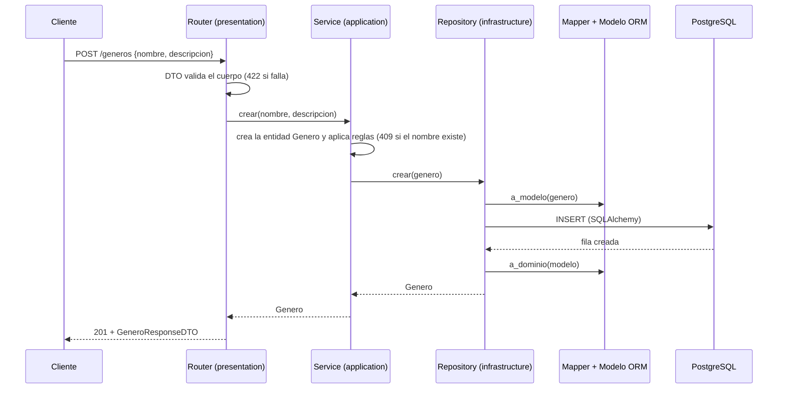
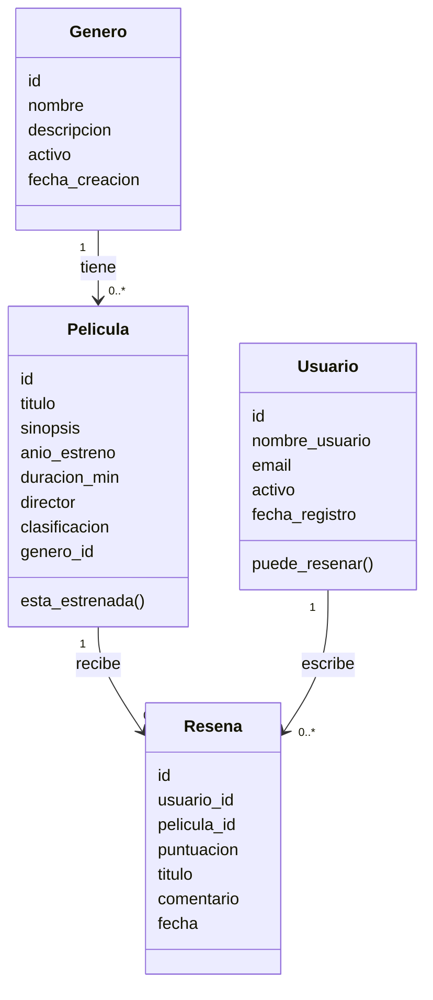
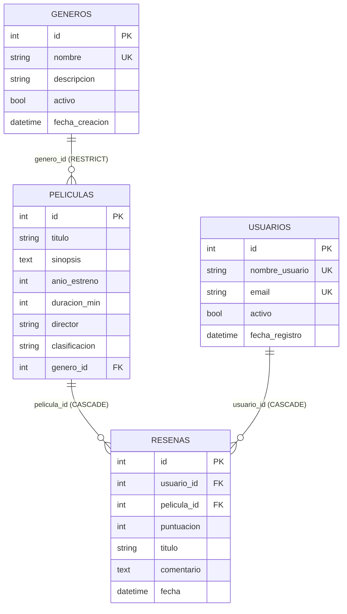

# API de Reseñas de Películas — backend-2026-grupo-04

Proyecto grupal de **Desarrollo de Backend (ICINF1108)**. API REST, estilo IMDb, donde las personas aficionadas al cine consultan un catálogo de películas organizado por género y publican reseñas con puntuación de 1 a 10.

> **Estado:** las cuatro entidades están implementadas e integradas en `main`, con 21 operaciones OpenAPI y cuatro seeders explícitos. Hay evidencias de 80 solicitudes HTTP con los códigos esperados y siete pruebas automatizadas aprobadas.

## Problemática

Quienes ven películas dejan sus opiniones repartidas en redes sociales y chats, sin una organización común por película y género. Esta API centraliza el catálogo y las reseñas: permite registrar películas y usuarios, publicar una única reseña por usuario y película y consultar el catálogo con filtros, orden y paginación.

---

## Funcionalidades

- Crear, consultar, actualizar y eliminar géneros, usuarios, películas y reseñas.
- Filtrar películas por género, año, clasificación y título, combinando ordenamiento y paginación.
- Consultar las reseñas de una película.
- Validar los datos y aplicar las reglas de publicación de reseñas.
- Guardar los datos en PostgreSQL y conservarlos después de reiniciar.
- Crear las tablas con Alembic y cargar datos de ejemplo con `uv run python -m app.seed`.
- Consultar la documentación y probar los endpoints desde `/docs`.

## Limitaciones

- El estreno de las películas se registra solo por año.
- No incluye interfaz gráfica, inicio de sesión, permisos, recomendaciones ni moderación automática.
- Al reiniciar PostgreSQL con la API funcionando, la primera consulta puede fallar por un problema de reconexión. Los datos se conservan.

## Problemática y alcance: P1–P7

Las siguientes respuestas definen el escenario propuesto por el equipo; no representan resultados de una investigación de usuarios.

- **P1. Situación:** las opiniones sobre películas quedan dispersas en chats y redes sociales, sin una organización común por título y género.
- **P2. Actores:** personas aficionadas al cine que consultan y publican opiniones; personas encargadas de mantener el catálogo. Estos actores no implican permisos implementados.
- **P3. Consecuencias:** dificultad para encontrar opiniones de una película y trabajo manual para mantener títulos y géneros consistentes.
- **P4. Información:** géneros, usuarios, películas y reseñas, con los atributos y relaciones indicados en los diagramas.
- **P5. Acciones previstas:** el sistema debe permitir crear géneros; consultar y mantener géneros; registrar usuarios; consultar y mantener usuarios; registrar películas con un género existente; consultar y mantener películas; filtrar, ordenar y paginar el catálogo; publicar una reseña por usuario y película; consultar y editar reseñas; eliminar reseñas; consultar reseñas de una película; recuperar cambios tras reiniciar. Las cuatro entidades tienen operaciones implementadas; la aceptación completa requiere las verificaciones finales.
- **P6. Exclusiones:** frontend, autenticación/autorización, recomendaciones o ranking automático, integración con plataformas externas y moderación automática.
- **P7. Aceptación prevista:** instalación desde copia limpia; cuatro entidades con ID y cuatro atributos útiles; al menos doce endpoints funcionales; CRUD persistente; rechazo de datos y referencias inválidas; tres reglas de negocio comprobables; filtro, orden y paginación en un mismo GET; seeders con al menos dos registros por entidad; pruebas reproducibles con esperado y obtenido. Estos objetivos no están todos completados.

## Usar con tu PostgreSQL existente en Docker

Conserva tu `.env`. El proyecto espera `DB_HOST`, `DB_PORT`, `DB_NAME`, `DB_USER` y `DB_PASSWORD` (ver ejemplo sin credenciales reales).
Si ejecutas la API en Windows y PostgreSQL en Docker, usa el host y puerto publicados del contenedor. No es necesario levantar otro contenedor con este Compose.
Ejecuta `uv sync`, `uv run alembic upgrade head`, `uv run python -m app.seed` y después `uv run uvicorn app.main:app --reload`.
Aplica la migración sobre una base destinada a este proyecto; si ya tiene tablas, revisa su estado antes de migrar. No borres volúmenes ni marques una migración como aplicada sin comprobar el esquema.

## Tecnologías

| Tecnología | Uso |
|---|---|
| Python 3.12+ | Lenguaje |
| FastAPI + Uvicorn | API HTTP y servidor |
| Pydantic | DTO y validación de entrada/salida |
| SQLAlchemy 2 | ORM (modelos, sesiones, consultas) |
| PostgreSQL 16 | Base de datos |
| Alembic | Migraciones versionadas |
| uv | Entorno virtual y dependencias |
| Docker Compose | PostgreSQL reproducible (opcional) |

---

## Ejecución desde una copia limpia

Los PR de las cuatro entidades y de las evidencias están fusionados en `main` en la versión auditada. La secuencia siguiente utiliza esa rama; las ramas de cada integrante se conservan para contribuciones posteriores.

Requisitos: Python 3.12+, [uv](https://docs.astral.sh/uv/), Git y Docker (o un PostgreSQL local).

```powershell
# 1. Clonar e instalar dependencias
git clone https://github.com/vfonseca2026-afk/backend-2026-grupo-04.git
cd backend-2026-grupo-04
uv sync

# 2. Solo si aún NO tienes un .env configurado
Copy-Item .env.example .env  # Solo PowerShell
# Si ya tienes un .env conectado a Docker, CONSÉRVALO y omite esta copia.
#    edita .env y cambia DB_PASSWORD

# 3. Base de datos PostgreSQL (con Docker)
docker compose up -d
docker compose ps
# Esperar a que el servicio db esté healthy.

# 4. Migraciones (crea las tablas desde cero)
uv run alembic upgrade head

# 5. Cargar las cuatro entidades explícitamente
uv run python -m app.seed

# 6. Iniciar la API
uv run uvicorn app.main:app --reload
```

- Swagger (OpenAPI interactivo): <http://127.0.0.1:8000/docs>
- ReDoc: <http://127.0.0.1:8000/redoc>
- Especificación JSON: <http://127.0.0.1:8000/openapi.json>

**Si el puerto 5432 está ocupado** (otro PostgreSQL o contenedor): cambia `DB_PORT=5433` en tu `.env` y vuelve a ejecutar `docker compose up -d`; el `docker-compose.yml` usa ese mismo valor.

**Sin Docker:** instala PostgreSQL, crea el usuario y la base con los mismos valores del `.env` y salta el paso 3.

En Linux, sustituir la copia de PowerShell por:

```bash
test -f .env || cp .env.example .env
nano .env
```

Los comandos `uv`, `git` y `docker compose` de la secuencia son los mismos. Docker debe estar instalado y en ejecución.
La aplicación usa el puerto 8000; cambiar el puerto de PostgreSQL no cambia el de Swagger.

### Variables de entorno (`.env.example`)

| Variable | Ejemplo | Descripción |
|---|---|---|
| `DB_HOST` | `127.0.0.1` | Servidor de la base |
| `DB_PORT` | `5432` | Puerto publicado de PostgreSQL |
| `DB_NAME` | `cine_resenas` | Nombre de la base |
| `DB_USER` | `cine` | Usuario |
| `DB_PASSWORD` | `cambiar_esta_clave` | Contraseña (poner una propia en tu `.env`) |

### Migraciones y seeders

- **Migraciones:** `migrations/versions/0001_crear_tablas.py` crea `generos`, `usuarios`, `peliculas` y `resenas` desde cero. Se aplican con `uv run alembic upgrade head` y se revierten con `uv run alembic downgrade base`.
- **Seeders disponibles:** Géneros, Usuarios, Películas y Reseñas. Ejecutar `uv run python -m app.seed` después de aplicar migraciones. El orden es Géneros → Usuarios → Películas → Reseñas. Cada tabla se carga solo si está vacía; si ya contiene registros, se omite. No se completan cargas parciales.
- **Datos de Usuarios:** seis usuarios ficticios, cinco activos y uno inactivo.
- **Datos de Reseñas:** diez reseñas ficticias creadas mediante el servicio sobre combinaciones distintas de usuarios activos y películas estrenadas. Se necesitan al menos diez combinaciones disponibles; las condiciones se comprueban antes de comenzar esa carga. Los IDs se recuperan de la base.
- **Datos de Películas:** diez películas ficticias repartidas entre dos géneros activos existentes, con diferentes duraciones, años y clasificaciones. Una tiene año de estreno igual al año de ejecución más uno. El seeder requiere al menos dos géneros activos y usa sus IDs reales, sin asumir valores fijos.
- **Repetición y cargas parciales:** repetir la carga completa omite las tablas ya pobladas. Cada repositorio confirma sus operaciones por separado; no existe una transacción única para todos los seeders. Si falla una ejecución después de guardar registros, revisar la carga parcial antes de repetirla. No borrar datos de trabajo para forzar una carga; usar una base de verificación aislada.
- **Arranque de la API:** iniciar o reiniciar Uvicorn no crea tablas ni ejecuta seeders. Las tablas vacías permanecen vacías hasta ejecutar la carga explícita o crear registros mediante la API.
- **Reiniciar sin borrar datos:** `docker compose restart db`. Para reiniciar solo la API, detener Uvicorn con Ctrl+C y volver a iniciarlo. No eliminar el volumen para comprobar persistencia.
- **Restablecimiento destructivo:** `docker compose down -v` elimina el volumen y sus datos. Reservar su uso para una base de pruebas descartable; después hay que levantar PostgreSQL, aplicar migraciones y ejecutar la carga inicial.
- **Persistencia:** los datos viven en el volumen `pgdata_resenas`; sobreviven al reinicio de la API y del contenedor.

---

## Arquitectura por capas

```text
app/main.py                  # crea y ensambla la API (routers y errores)
app/seed.py                  # carga inicial explícita: python -m app.seed
presentation/                # CAPA DE PRESENTACIÓN: recibe HTTP
    dependencies.py          #   sesión por solicitud e inyección de servicios
    error_handlers.py        #   errores -> JSON uniforme
    routers/                 #   endpoints
    schemas/dtos/            #   DTO de entrada/salida y validación
application/services/        # CAPA DE APLICACIÓN: casos de uso y reglas de negocio
domain/                      # CAPA DE DOMINIO: entidades y errores (sin FastAPI ni BD)
infrastructure/              # CAPA DE INFRAESTRUCTURA
    database.py              #   conexión y sesiones
    models/                  #   modelos ORM (tablas)
    mappers/                 #   conversión modelo ORM <-> entidad de dominio
    repositories/            #   único lugar con consultas a la BD
    seeders/                 #   datos iniciales
migrations/                  # migraciones Alembic (env.py, versions/)
tests_manual/                # pruebas .http y evidencias
docs/                        # backlog y documentación
```

| Capa | Responsabilidad | Qué NO hace |
|---|---|---|
| **presentation** | Recibe HTTP, valida con DTO, llama al servicio y devuelve la respuesta | No contiene lógica de negocio ni consultas a la BD |
| **application** | Coordina casos de uso y aplica reglas de negocio | No conoce HTTP ni SQL |
| **domain** | Entidades, invariantes y errores del dominio | No depende del framework ni de la BD |
| **infrastructure** | Conexión, modelos ORM, mappers, repositorios, seeders | No decide reglas de negocio |

### Recorrido de una solicitud



Los errores viajan como excepciones de dominio (`RecursoNoEncontradoError`, `ConflictoError`, `ReglaNegocioError`) y `presentation/error_handlers.py` las convierte en el JSON uniforme.

---

## Modelo del dominio

### Diagrama de clases



### Diagrama de datos (tablas)



### Restricciones de integridad

- `usuarios.nombre_usuario` y `usuarios.email` son únicos.
- `generos.nombre` es único en la base. La comparación sin distinguir
  mayúsculas se realiza en el servicio mediante el repositorio.
- `UNIQUE (usuario_id, pelicula_id)` impide que un usuario registre
  dos reseñas de la misma película.
- La puntuación de una reseña debe estar entre 1 y 10.
- La duración de una película debe ser mayor que cero.
- La clasificación admite únicamente `TP`, `+14` y `+18`.
- No se puede eliminar un género mientras tenga películas asociadas.
- Eliminar un usuario o una película elimina sus reseñas asociadas.

Estas restricciones describen los modelos previstos. Su aplicación en
PostgreSQL depende de que las migraciones correspondientes estén aplicadas.

### Reglas de negocio

| # | Regla | Respuesta | Estado |
|---|---|---|---|
| RN1 | Un usuario solo puede reseñar una película una vez | 409 | Implementada |
| RN2 | No se puede reseñar una película cuyo año de estreno sea posterior al año actual | 400 | Implementada |
| RN3 | Un usuario inactivo no puede publicar reseñas | 400 | Implementada |
| RN4 | No se puede eliminar un género que tiene películas | 409 | ✅ |

### Validaciones de datos

| Tipo | Ejemplo | Estado |
|---|---|---|
| Longitud | nombre de género 2–50; título de reseña 1–100; comentario 10–2000 | Implementada |
| Numérica | duración > 0; año >= 1888; límite 1–100; puntuación 1–10 | Implementada |
| Valores permitidos | clasificación `TP`, `+14`, `+18`; `direccion` asc/desc | Implementado en Películas |
| Formato | email válido | Implementado en Usuarios |
| Existencia relacionada | Género existente en Películas; usuario y película existentes al publicar Reseñas | Implementada |
| Regla de negocio | RN1–RN4 | ver arriba |

---

## Contrato REST

Documentado en Swagger (`/docs`). Todas las colecciones usan sustantivos en plural. Estado «Implementado» describe el código y registro de la operación; no acredita su verificación HTTP final.

| Método | URI | Descripción | Éxito | Errores | Estado |
|---|---|---|---|---|---|
| POST | `/generos` | Crear género | 201 | 409, 422 | Implementado |
| GET | `/generos` | Listar géneros | 200 | 422 | Implementado |
| GET | `/generos/{genero_id}` | Obtener género | 200 | 404, 422 | Implementado |
| PUT | `/generos/{genero_id}` | Actualizar género | 200 | 404, 409, 422 | Implementado |
| DELETE | `/generos/{genero_id}` | Eliminar género | 204 | 404, 409, 422 | Implementado |
| POST | `/usuarios` | Crear usuario | 201 | 409, 422 | Implementado |
| GET | `/usuarios` | Listar usuarios (paginado) | 200 | 422 | Implementado |
| GET | `/usuarios/{usuario_id}` | Obtener usuario | 200 | 404, 422 | Implementado |
| PUT | `/usuarios/{usuario_id}` | Actualizar usuario | 200 | 404, 409, 422 | Implementado |
| DELETE | `/usuarios/{usuario_id}` | Eliminar usuario | 204 | 404, 422 | Implementado |
| POST | `/peliculas` | Crear película | 201 | 404, 422 | Implementado |
| GET | `/peliculas` | Listar con **filtro + orden + paginación** | 200 | 422 | Implementado |
| GET | `/peliculas/{pelicula_id}` | Obtener película | 200 | 404, 422 | Implementado |
| PUT | `/peliculas/{pelicula_id}` | Actualizar película | 200 | 404, 422 | Implementado |
| DELETE | `/peliculas/{pelicula_id}` | Eliminar película | 204 | 404, 422 | Implementado |
| POST | `/resenas` | Crear reseña | 201 | 400, 404, 409, 422 | Implementado |
| GET | `/resenas` | Listar reseñas (paginado) | 200 | 422 | Implementado |
| GET | `/resenas/{resena_id}` | Obtener reseña | 200 | 404, 422 | Implementado |
| PUT | `/resenas/{resena_id}` | Actualizar reseña | 200 | 400, 404, 422 | Implementado |
| DELETE | `/resenas/{resena_id}` | Eliminar reseña | 204 | 404, 422 | Implementado |
| GET | `/peliculas/{pelicula_id}/resenas` | Reseñas de una película | 200 | 404, 422 | Implementado |

### Contrato disponible de Géneros

- **POST:** `nombre` obligatorio (2–50 caracteres); `descripcion` opcional (máximo 255, predeterminado vacío). Los textos se recortan y los campos adicionales se rechazan.
- **GET de colección:** `solo_activos=false` devuelve todos; `solo_activos=true` excluye inactivos. La lista se ordena por nombre. Este endpoint no implementa paginación.
- **GET por ID:** exige un entero positivo; devuelve 404 si no existe.
- **PUT:** exige `nombre`, `descripcion` y `activo`. La descripción puede estar vacía. Conserva ID y fecha de creación. Omitir un campo obligatorio produce 422.
- **DELETE:** devuelve 204 sin cuerpo; un género con películas asociadas produce 409.
- Los nombres duplicados se comprueban sin distinguir mayúsculas mediante el servicio y el repositorio. Se permite actualizar un registro conservando su propio nombre. La unicidad sin distinguir mayúsculas ante concurrencia no está garantizada por un índice específico de PostgreSQL en esta versión.
- Router y DTO contienen descripciones y ejemplos OpenAPI. Los ejemplos son ilustrativos y no constituyen resultados de ejecución.

Ejemplo de PUT sobre un ID existente:

```json
{
  "nombre": "Drama",
  "descripcion": "Historias centradas en personajes.",
  "activo": true
}
```

### Contrato de Películas

- POST crea una película con un género existente y devuelve 201.
- GET por ID devuelve la película o 404 si no existe; los IDs deben ser positivos.
- PUT reemplaza todos los campos editables y conserva el ID. El género relacionado debe existir.
- DELETE elimina la película y devuelve 204 sin cuerpo. La eliminación de sus reseñas asociadas fue comprobada en T24; la eliminación de reseñas al borrar usuarios fue comprobada en T23.
- Se permite registrar una película futura. El servicio de Reseñas rechaza publicar o editar una reseña cuando el año de estreno es posterior al actual.

| Campo de entrada | Validación |
|---|---|
| `titulo` | Entre 1 y 150 caracteres |
| `sinopsis` | Máximo 2000; opcional en POST, obligatoria en PUT; puede estar vacía |
| `anio_estreno` | Mayor o igual que 1888 |
| `duracion_min` | Mayor que cero |
| `director` | Entre 1 y 100 caracteres |
| `clasificacion` | `TP`, `+14` o `+18` |
| `genero_id` | Entero positivo; existencia comprobada en el servicio |

Los DTO recortan espacios al principio y al final y rechazan campos adicionales. Los datos inválidos producen 422; una película o un género relacionado inexistente producen 404.

Ejemplo de POST o PUT —usar un género existente—:

```json
{
  "titulo": "Horizonte lejano",
  "sinopsis": "Una expedición explora un planeta desconocido.",
  "anio_estreno": 2020,
  "duracion_min": 110,
  "director": "Ana Ejemplo",
  "clasificacion": "TP",
  "genero_id": 1
}
```

### Filtro, orden y paginación de Películas

`GET /peliculas` combina las tres operaciones sobre datos persistidos.

| Parámetro | Comportamiento |
|---|---|
| `genero_id` | Filtro opcional por género; entero positivo |
| `anio` | Filtro opcional por año exacto; mínimo 1888 |
| `clasificacion` | Filtro opcional: `TP`, `+14`, `+18` |
| `titulo` | Texto contenido, sin distinguir mayúsculas; 1–150 caracteres |
| `ordenar_por` | `titulo`, `anio_estreno` o `duracion_min`; predeterminado `titulo` |
| `direccion` | `asc` o `desc`; predeterminado `asc` |
| `pagina` | Desde 1; predeterminado 1 |
| `limite` | Entre 1 y 100; predeterminado 10 |

Ejemplo —reemplazar el ID de género por uno existente—:

```text
GET /peliculas?genero_id=1&ordenar_por=duracion_min&direccion=desc&pagina=1&limite=3
```

Orden de ejecución: filtrar, contar coincidencias, ordenar y paginar. El ID ascendente se usa como criterio secundario para desempatar. Las columnas de orden están limitadas a una lista permitida.

`total` representa todos los registros filtrados antes de paginar. `total_paginas` es el redondeo hacia arriba de `total / limite`; si no hay coincidencias, es cero. Una página posterior a la última devuelve `items` vacío, conservando los metadatos de todas las coincidencias.

Ejemplo sin coincidencias:

```json
{
  "items": [],
  "total": 0,
  "pagina": 1,
  "limite": 3,
  "total_paginas": 0
}
```

### Recorrido de una solicitud de Películas

1. El router recibe HTTP y el DTO valida el cuerpo o los parámetros.
2. La dependencia construye el servicio con repositorios que comparten la sesión de la solicitud.
3. El servicio comprueba la existencia de recursos y coordina la operación.
4. El repositorio accede a PostgreSQL mediante modelos SQLAlchemy.
5. El mapper convierte entre modelos ORM y entidades del dominio.
6. El router devuelve el DTO de respuesta, o el manejador central traduce una excepción controlada.

### Contrato de Reseñas

- POST `/resenas` recibe usuario, película, puntuación, título y comentario. Comprueba referencias existentes, usuario activo, año de estreno permitido y ausencia de reseña previa del mismo usuario para esa película.
- GET `/resenas` lista por ID ascendente y admite `usuario_id` y `pelicula_id` como filtros opcionales positivos, además de `pagina` (desde 1) y `limite` (1–100). Los filtros sin coincidencias devuelven una colección vacía.
- GET `/resenas/{resena_id}` consulta por ID positivo o devuelve 404.
- PUT `/resenas/{resena_id}` exige puntuación, título y comentario. No admite cambiar usuario ni película. Conserva ID y fecha y vuelve a exigir usuario activo y película con año permitido.
- DELETE `/resenas/{resena_id}` elimina y devuelve 204 sin cuerpo. No exige que el autor continúe activo; una reseña inexistente produce 404.
- GET `/peliculas/{pelicula_id}/resenas` comprueba la existencia de la película y devuelve sus reseñas paginadas por ID. Una película existente sin reseñas devuelve 200 con colección vacía; una inexistente, 404.
- La respuesta incluye `id`, `usuario_id`, `pelicula_id`, `puntuacion`, `titulo`, `comentario` y `fecha` generada al crear.
- Las colecciones devuelven `items`, `total`, `pagina`, `limite` y `total_paginas`. El total se calcula antes de paginar, sobre las coincidencias.

| Campo | Validación |
|---|---|
| `usuario_id`, `pelicula_id` | Enteros positivos, obligatorios al crear y no editables |
| `puntuacion` | Entre 1 y 10, inclusive |
| `titulo` | Entre 1 y 100 caracteres |
| `comentario` | Entre 10 y 2000 caracteres |

Los DTO recortan espacios y rechazan campos adicionales. Los errores de esquema producen 422; referencias inexistentes, 404; usuario inactivo o película futura, 400; reseña duplicada, 409. Ante solicitudes simultáneas duplicadas, la restricción única de PostgreSQL conserva la integridad y el manejador de integridad devuelve 409.

Ejemplo de POST —sustituir por IDs reales de un usuario activo y una película estrenada sin reseña previa entre ambos—:

```json
{
  "usuario_id": 1,
  "pelicula_id": 1,
  "puntuacion": 8,
  "titulo": "Una historia recomendable",
  "comentario": "Buenos personajes y una historia entretenida."
}
```

Para PUT, enviar únicamente `puntuacion`, `titulo` y `comentario`.

### Recorrido de una publicación de Reseña

1. El DTO valida el cuerpo de POST `/resenas`.
2. `get_resena_service` construye el servicio con repositorios de Reseñas, Usuarios y Películas que comparten la sesión.
3. El servicio recupera el usuario y la película, aplica las reglas y comprueba duplicados.
4. Crea la entidad de dominio y solicita al repositorio su persistencia.
5. El mapper produce el modelo ORM; SQLAlchemy guarda, confirma y recupera la fila con ID y fecha.
6. El mapper devuelve la entidad y el router serializa `ResenaResponseDTO` con estado 201.

### Formato uniforme de errores

```json
{ "error": { "code": "RESOURCE_NOT_FOUND", "message": "No existe un género con el ID solicitado.", "details": [] } }
```

| Código HTTP | `code` | Cuándo |
|---|---|---|
| 400 | `BUSINESS_RULE_VIOLATION` | Viola una regla de negocio |
| 404 | `RESOURCE_NOT_FOUND` | El recurso no existe |
| 409 | `RESOURCE_CONFLICT` | Duplicado o conflicto con el estado actual |
| 422 | `VALIDATION_ERROR` | Datos que no cumplen el esquema (`details` lista cada campo) |

---

## Pruebas

Las solicitudes están en [tests_manual/pruebas.http](tests_manual/pruebas.http) y la matriz con resultados en [tests_manual/evidencias.md](tests_manual/evidencias.md).

La ejecución sobre `backend04_pruebas_finales_01` incluye 80 solicitudes HTTP con los estados esperados y comprobaciones de CRUD, validaciones, referencias, reglas, filtro/orden/paginación, cascadas y persistencia. La carga desde cero se respalda con la ejecución inicial aportada por Vicente; la ejecución asistida posterior utilizó esa misma base ya poblada y comprobó también que repetir los seeders conserva las cantidades.

- [Solicitudes, respuestas y comandos](tests_manual/resultados/20261102T050815Z/ejecucion.md).
- [Resultados estructurados](tests_manual/resultados/20261102T050815Z/resultados.json).
- [Comprobación suplementaria de persistencia](tests_manual/resultados/20261102T050815Z/persistencia_adicional.json).

El intento inicial de reiniciar PostgreSQL mediante Docker CLI falló por permisos del entorno. Se completó mediante Docker Desktop, conservando el volumen, y se comprobó el cambio de inicio del servidor. Ese problema de acceso no equivale al fallo funcional T28, descrito abajo.

La API temporal de la ejecución asistida utilizó el puerto 8002 con el nombre de base explícito; las comprobaciones manuales previas usaron 8001. Los archivos no implican que alguna de esas APIs siga en ejecución.

La tabla principal contiene resultados de los 27 casos previstos. La tabla auxiliar de IDs QA aún debe completarse con los IDs de la corrida correspondiente. Los respaldos históricos, incluido `evidencias_antes.md`, no representan el estado actual.

Para repetir: crear una base exclusiva nueva, aplicar migraciones, ejecutar seeders y seguir las solicitudes en orden. Registrar los nuevos resultados y el commit probado; no reutilizar datos de una corrida anterior como si la base estuviera vacía. El procedimiento detallado está en evidencias.md. La prueba de persistencia conserva el volumen y no utiliza `down -v`.

## Integrantes y responsabilidades

| Integrante | Área de responsabilidad | Foco técnico |
|---|---|---|
| Vicente Fonseca (jefe de grupo) | Coordinación y seguimiento + Documentación e integración | Géneros, backlog, README, OpenAPI, diagramas e integración de PR |
| Matías Manquelaf | Dominio y datos | Usuarios, modelo persistente, migración, seeders |
| Miguel Torres | API y lógica de negocio | Películas, filtro/orden/paginación |
| Danna Ramirez | Calidad y pruebas | Reseñas y reglas de negocio, pruebas y evidencias |

Las áreas indican seguimiento principal, no tareas exclusivas: todos participan en implementación, pruebas e integración.

## Flujo de trabajo con Git

| Integrante | Rama de trabajo |
|---|---|
| Vicente Fonseca | `feature/integracion-documentacion` |
| Matías Manquelaf | `feature/usuarios` |
| Miguel Torres | `feature/peliculas` |
| Danna Ramirez | `feature/resenas` |

- Cada integrante hace commits significativos y publica avances en su rama durante los hitos.
- Acuerdo del equipo: abrir un PR por integrante cuando su trabajo esté listo. No se exige un PR por commit ni por hito.
- Antes de integrar: actualizar la rama con `main`, resolver conflictos y comprobar funcionamiento.
- Orden de integración de dependencias: Usuarios, Películas y luego Reseñas. Vicente coordina su PR de Géneros, documentación e integración.
- Si una dependencia necesita integrarse antes, se podrá abrir un PR adicional; la rúbrica exige al menos uno, no un máximo de uno.
- Los PR requieren revisión de otra persona. La protección de `main` debe configurarse y comprobarse en GitHub; este documento no acredita su activación.
- Cada integrante debe completar al menos cinco commits propios y significativos, una rama distinta de `main` y un PR.
- `.env` y `.venv` no se suben; solo se comparte `.env.example` sin credenciales reales.


## Verificación y alcance de las pruebas existentes

```powershell
uv run python -m unittest discover -s tests -v
uv run alembic current
uv run alembic check
```

La prueba del contrato exige las 21 combinaciones exactas de ruta y método. Las siete pruebas se ejecutaron nuevamente sobre la copia del commit integrado `950b047` y aprobaron. Las evidencias previas registran `0001 (head)` y `No new upgrade operations detected.` en Alembic. La auditoría de `950b047` confirmó que el código de aplicación no cambió desde el commit `04576be` probado por HTTP; las diferencias posteriores corresponden a documentación de evidencias.

El resto de la batería conserva principalmente el alcance de Géneros. La comprobación del contrato confirma registro y documentación, no ejecuta las 21 operaciones.

Los tests automatizados invocan las funciones de rutas y servicios con una base SQLite temporal aislada: verifican CRUD, validaciones, excepciones de dominio, contrato y conservación al reabrir conexiones. No son pruebas HTTP de extremo a extremo ni verifican los manejadores HTTP. No sustituyen la prueba de migraciones y reinicio con PostgreSQL. Las comprobaciones HTTP y de PostgreSQL están registradas en `tests_manual/evidencias.md` y sus respaldos. Una nueva modificación de código requiere repetir las pruebas que pueda afectar.

## Estado de contribuciones e integración

El historial incluido en la auditoría de `950b047` conserva commits sin merges y PR fusionados desde las cuatro ramas:

| Integrante | Autor Git | Commits sin merges |
|---|---|---:|
| Vicente Fonseca | `vfonseca2026-afk` | 11 |
| Matías Manquelaf | `mmanquelaf` | 9 |
| Miguel Torres | `migueltorres2026-ui` | 6 |
| Danna Ramirez | `Danna-Ramirez` | 6 |

Estos conteos corresponden a esa revisión y aumentarán con los siguientes avances. El historial local no certifica quién abrió o aprobó cada PR, ni el acceso del docente o las reglas activas de protección de GitHub; verificar esos puntos en la plataforma.


## Documentos de seguimiento

- [Backlog actualizado](docs/backlog.md): avances comprobados, pendientes y limitaciones.
- [Estado inicial histórico](docs/estado-inicial.md): describe únicamente la base de partida; sus pendientes originales no representan el estado final.
- [Evidencias vigentes](tests_manual/evidencias.md): resultados y alcance de las comprobaciones.

Antes de agregar archivos, revisar `git status --short`; `.env`, `.venv` y credenciales reales no se publican. Si un archivo ya estaba versionado, agregarlo a .gitignore no lo retira del historial.
